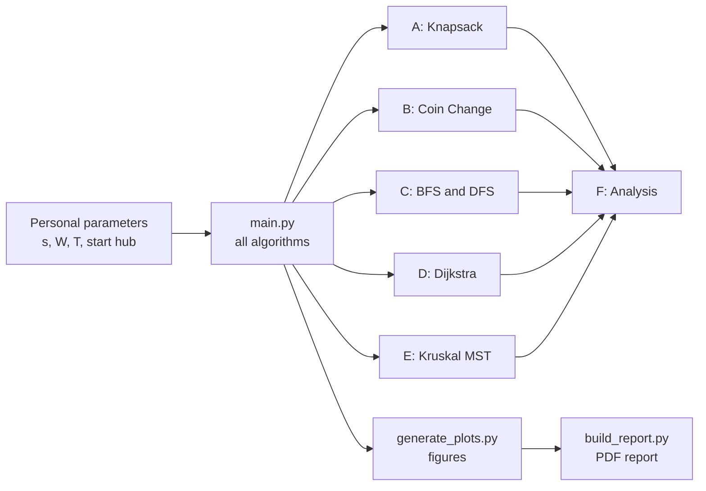
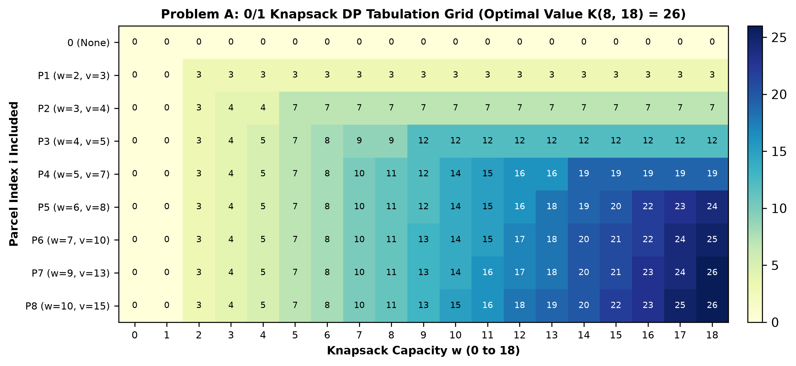
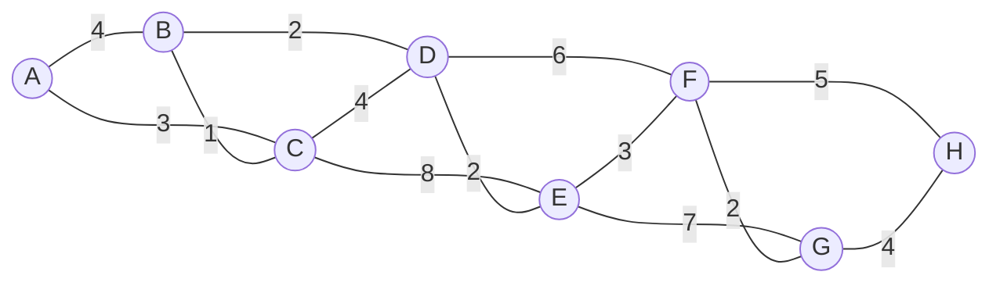
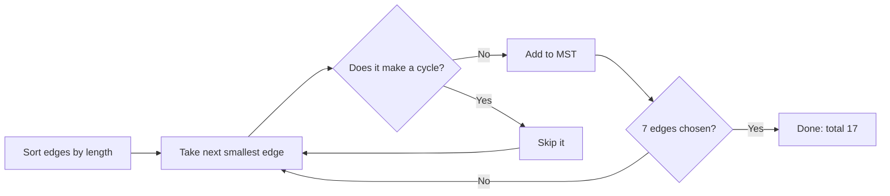
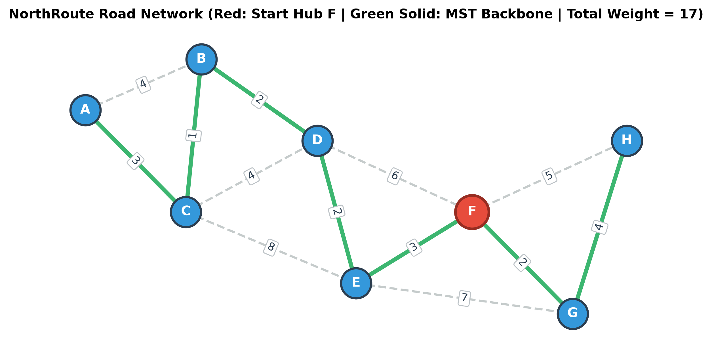

<div align="center">


<a href="https://git.io/typing-svg">
  
</a>

<br/>


<br/>


</div>

---

## Table of Contents

- [About the Project](#about-the-project)
- [Student Information](#student-information)
- [Personal Parameters](#personal-parameters)
- [How the Project Fits Together](#how-the-project-fits-together)
- [Tech Stack](#tech-stack)
- [Folder Structure](#folder-structure)
- [Setup and Run](#setup-and-run)
- [Results at a Glance](#results-at-a-glance)
- [Problem A: The Van Loader](#problem-a-the-van-loader)
- [Problem B: Making Change](#problem-b-making-change)
- [Problem C: The Road Map](#problem-c-the-road-map)
- [Problem D: Shortest Routes](#problem-d-shortest-routes)
- [Problem E: The Backbone](#problem-e-the-backbone)
- [Problem F: Analysis and Reasoning](#problem-f-analysis-and-reasoning)
- [AI Use Disclosure](#ai-use-disclosure)

---

## About the Project

NorthRoute is a small courier that moves parcels between eight city hubs. Two kinds of daily decisions run the business.

| Area | Question | Idea used |
|------|----------|-----------|
| Loading and paying | Which parcels should go in the van? What is the fewest coins for a bill? | Dynamic programming |
| Road network | Which hubs can we reach? What is the shortest route? What is the cheapest cable plan? | Graph algorithms |

All algorithms are written from scratch in Python. This project was built for Assignment 3 at FAST NUCES, Islamabad Campus (Fall 2026).

---

## Student Information

| Field | Value |
|-------|-------|
| Name | Abdul Azeem |
| Roll Number | 24i-2013 |
| Section | BAI-5A |

---

## Personal Parameters

Some inputs depend on the roll number. The last three digits of `24i-2013` are `013`, so **s = 13**.

| Parameter | Formula | Value |
|-----------|---------|-------|
| s | last 3 digits of roll number | **13** |
| W (van capacity) | 15 + (13 mod 10) = 15 + 3 | **18** |
| T (change amount) | 30 + (13 mod 20) = 30 + 13 | **43** |
| Start hub index | 13 mod 8 = 5 | **5** |
| Start hub | A=0, B=1, C=2, D=3, E=4, F=5, G=6, H=7 | **Hub F** |

---

## How the Project Fits Together



---

## Tech Stack

<div align="center">


</div>

**Algorithm code (main.py)**
- `collections.deque` for the BFS queue.
- `heapq` for the priority queue in Dijkstra and Prim.
- Custom Union-Find (path compression and union by rank) for Kruskal.
- 2D tabulation and recursion with memoization for knapsack and coin change.

**Report and figures**
- Matplotlib, NetworkX and NumPy draw the road network and the knapsack table.
- ReportLab builds the PDF report with page numbers.
- PyPDF2 checks that the report stays within 5 pages.

---

## Folder Structure

```text
northroute-optimizer/
|-- 24i-2013-A3-BAI-5A.pdf    # Final typed report (5 pages)
|-- build_report.py           # Builds the PDF report with ReportLab
|-- generate_plots.py         # Draws the graph and the DP table figures
|-- knapsack_table.png        # Knapsack DP table (heatmap)
|-- main.py                   # All algorithms for Problems A to F
|-- README.md                 # This file
`-- road_network.png          # Road network with MST highlighted
```

| File | What it does |
|------|--------------|
| `main.py` | Runs every algorithm and prints all results: knapsack (top-down and bottom-up), coin change with greedy comparison, graph list and matrix, BFS, DFS, components, cycle check, Dijkstra, Kruskal with a Prim check, and the analysis. |
| `generate_plots.py` | Creates `road_network.png` and `knapsack_table.png`. |
| `build_report.py` | Builds the PDF report and embeds the figures. |
| `24i-2013-A3-BAI-5A.pdf` | The report that was submitted. |

---

## Setup and Run

The algorithms in `main.py` use only the Python standard library (`collections` and `heapq`). No install is needed to run them.

**1. Run all algorithms**

```bash
python3 main.py
```

On some systems the command is:

```bash
python main.py
```

**2. Install extra packages (only for plots and the PDF)**

```bash
pip install reportlab matplotlib networkx numpy PyPDF2
```

**3. Redraw the figures (optional)**

```bash
python3 generate_plots.py
```

**4. Rebuild the PDF report (optional)**

```bash
python3 build_report.py
```

---

## Results at a Glance

| Problem | Topic | Key Result |
|---------|-------|------------|
| A | 0/1 Knapsack | Best value **26** with parcels P1, P6, P7 (weight 18 of 18) |
| B | Coin Change | **6 coins** for 43: 9, 9, 9, 9, 4, 3 |
| C | BFS and DFS | 1 component, cycle exists, F to H is 1 road |
| D | Dijkstra | Shortest F to H is **5** (F -> H) |
| E | MST (Kruskal) | Total length **17** with 7 edges |
| F | Analysis | Complexity table, greedy vs DP, n vs W, MST vs shortest path tree |

---

## Problem A: The Van Loader

**Goal:** Pick parcels to get the most value without going over capacity W = 18. Each parcel can be taken once.

**Recurrence:** Let `K(i, w)` be the best value using the first `i` parcels with capacity `w`.

```text
Base:      K(0, w) = 0   and   K(i, 0) = 0
Too heavy: if wt[i] > w  then  K(i, w) = K(i-1, w)
Otherwise: K(i, w) = max( K(i-1, w),  K(i-1, w - wt[i]) + val[i] )
```

| Item | Result |
|------|--------|
| Top-down memoized value | 26 |
| Bottom-up tabulated value | 26 (both match) |
| Chosen parcels | P1 (w2, v3), P6 (w7, v10), P7 (w9, v13) |
| Total weight and value | 18 / 18 and 26 |
| Time | O(n * W) = 8 * 18 = 144 cell computations |
| Space | O(n * W) |

**How parcels are traced back:** Start at cell `(8, 18)`. If `table[i][w]` is different from `table[i-1][w]`, parcel `i` was taken, so subtract its weight from `w`. If they are equal, the parcel was skipped. Move up one row each time.

**Why pseudo-polynomial:** The time depends on the number value W, not on how many bits it takes to write W. With `b = log2(W)` bits, the time is O(n * 2^b), which is exponential in the input size.

<div align="center">
  
  <br/>
  <sub>Knapsack DP table. The darkest cell at the bottom right is the answer, 26.</sub>
</div>

---

## Problem B: Making Change

**Goal:** Make T = 43 with the fewest coins from {1, 3, 4, 9}.

```text
Base:        C(0) = 0
Recurrence:  C(t) = min( C(t - c) + 1 )  for every coin c <= t
Impossible:  amounts that cannot be made are set to infinity
```

| Item | Result |
|------|--------|
| DP minimum for 43 | 6 coins |
| Coins used | 9, 9, 9, 9, 4, 3 |
| Greedy for 43 | 6 coins (same as DP) |
| Time and space | O(n * T) and O(T) |

**Greedy can fail.** Take the amount **6**:

| Method | Coins | Count |
|--------|-------|-------|
| DP | 3, 3 | 2 |
| Greedy | 4, 1, 1 | 3 |

Reason: Greedy grabs the big coin 4 first. The leftover 2 needs two 1-coins, so it misses the better pair of 3s.

---

## Problem C: The Road Map

**The network:** 8 hubs and 13 undirected roads.



**Representation space**

| Structure | Space | Good for this graph? |
|-----------|-------|----------------------|
| Adjacency list | O(V + E) = 8 + 13 = 21 entries | Yes, the graph is sparse |
| Adjacency matrix | O(V^2) = 64 cells | No, many empty cells |

**Traversals from Hub F (neighbours in alphabetical order)**

| Algorithm | Visit order |
|-----------|-------------|
| BFS | F, D, E, G, H, B, C, A |
| DFS | F, D, B, A, C, E, G, H |

**Hop distances from F (BFS)**

| Hub | A | B | C | D | E | F | G | H |
|-----|---|---|---|---|---|---|---|---|
| Hops | 3 | 2 | 2 | 1 | 1 | 0 | 1 | 1 |

**Structure checks**
- Connected components: **1**, so the graph is connected.
- Cycle: **Yes**, for example B -> C -> A -> B. There are E - V + 1 = 6 independent cycles.
- Smallest number of roads from F to H: **1** (the direct road F-H).

---

## Problem D: Shortest Routes

**Goal:** Find the shortest distance from Hub F to every hub using Dijkstra with a `heapq` min-heap.

| Hub | Distance | Shortest path |
|-----|----------|---------------|
| A | 11 | F -> E -> D -> B -> A |
| B | 7 | F -> E -> D -> B |
| C | 8 | F -> E -> D -> B -> C |
| D | 5 | F -> E -> D |
| E | 3 | F -> E |
| F | 0 | F |
| G | 2 | F -> G |
| H | 5 | F -> H |

**Path to H:** F -> H with length 5. The other route F -> G -> H is longer (2 + 4 = 6).

**Time complexity**
- Binary heap: O((V + E) log V)
- Plain array scan: O(V^2)

**If every road had length 1:** Dijkstra distances would be the same as BFS hop distances, because the queue then grows in steps of one, just like BFS.

---

## Problem E: The Backbone

**Goal:** Connect all 8 hubs with the least total cable length. Kruskal's algorithm with Union-Find was used and checked against Prim.



| Step | Edge | Length | Decision |
|------|------|--------|----------|
| 1 | B-C | 1 | Accepted |
| 2 | B-D | 2 | Accepted |
| 3 | D-E | 2 | Accepted |
| 4 | F-G | 2 | Accepted |
| 5 | A-C | 3 | Accepted |
| 6 | E-F | 3 | Accepted |
| 7 | A-B | 4 | Rejected (cycle) |
| 8 | C-D | 4 | Rejected (cycle) |
| 9 | G-H | 4 | Accepted |

**Total MST length: 17.** Prim gives the same total.

**Complexity:** Kruskal is O(E log V). Prefer Prim on dense graphs (E close to V^2), where an adjacency matrix version runs in O(V^2) with no sorting.

<div align="center">
  
  <br/>
  <sub>Red node is the start hub F. Green solid roads form the MST. Gray dashed roads are not used.</sub>
</div>

---

## Problem F: Analysis and Reasoning

**Complexity table**

| Algorithm | Time | Space | Technique |
|-----------|------|-------|-----------|
| 0/1 Knapsack | O(n * W) | O(n * W) | Dynamic programming |
| Coin change | O(n * T) | O(T) | Dynamic programming |
| BFS and DFS | O(V + E) | O(V) | Traversal |
| Dijkstra | O((V + E) log V) | O(V + E) | Greedy |
| Kruskal MST | O(E log V) | O(V + E) | Greedy |
| Prim MST | O((V + E) log V) | O(V + E) | Greedy |

**Greedy vs DP**
- Greedy fails in coin change: for amount 6 it gives 4, 1, 1 (3 coins) but DP gives 3, 3 (2 coins).
- Greedy is provably correct in Dijkstra. All road lengths are not negative, so the closest unvisited hub can never be reached faster by going through another unvisited hub.

**Doubling n or doubling W?**

Both double the table size, as the bound is O(n * W).

| Case | n | W | Cells |
|------|---|---|-------|
| Original | 8 | 18 | 144 |
| Double n | 16 | 18 | 288 |
| Double W | 8 | 36 | 288 |

Doubling W adds just one bit to the input, yet it doubles the work. That is the pseudo-polynomial effect.

**MST vs shortest path tree**

An MST keeps the total cable length as small as possible for all hubs. A shortest path tree keeps the distance from one source hub as small as possible. Example: the road F-H (length 5) is on the shortest route from F to H, but the MST uses G-H (length 4) instead, so the tree path from F to H becomes 2 + 4 = 6.

---

## AI Use Disclosure

An AI assistant was used for code structure, formatting and drafting text. All algorithm results, tables and complexity reasoning were checked by running the code with the personal parameters of Abdul Azeem (Roll No: 24i-2013). The author can explain and modify any part of the code.

---

<div align="center">


</div>